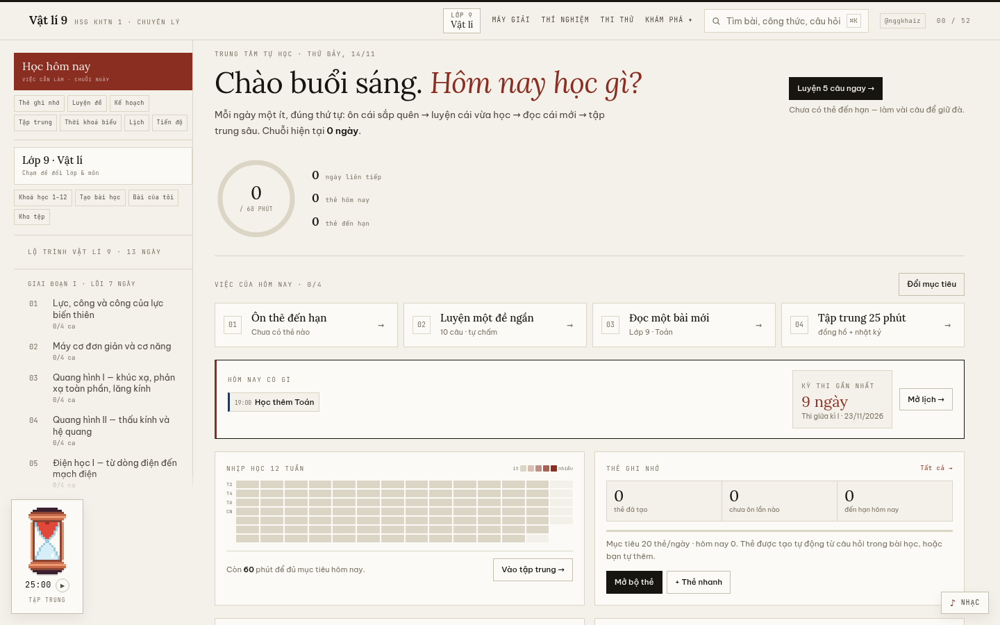
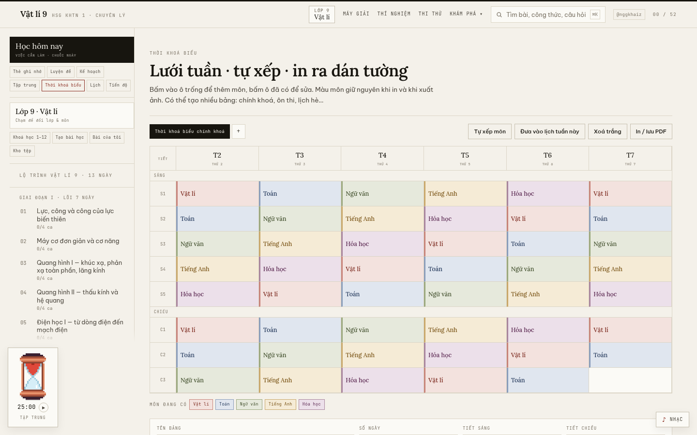
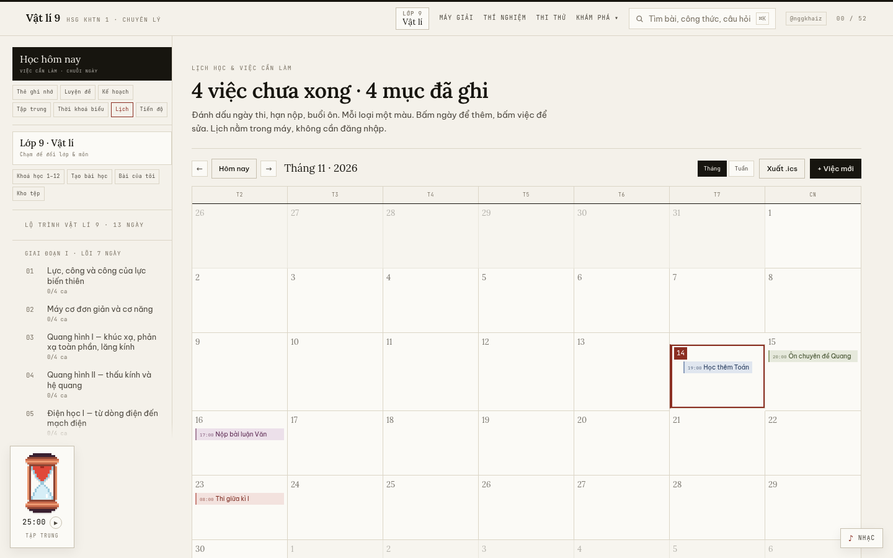
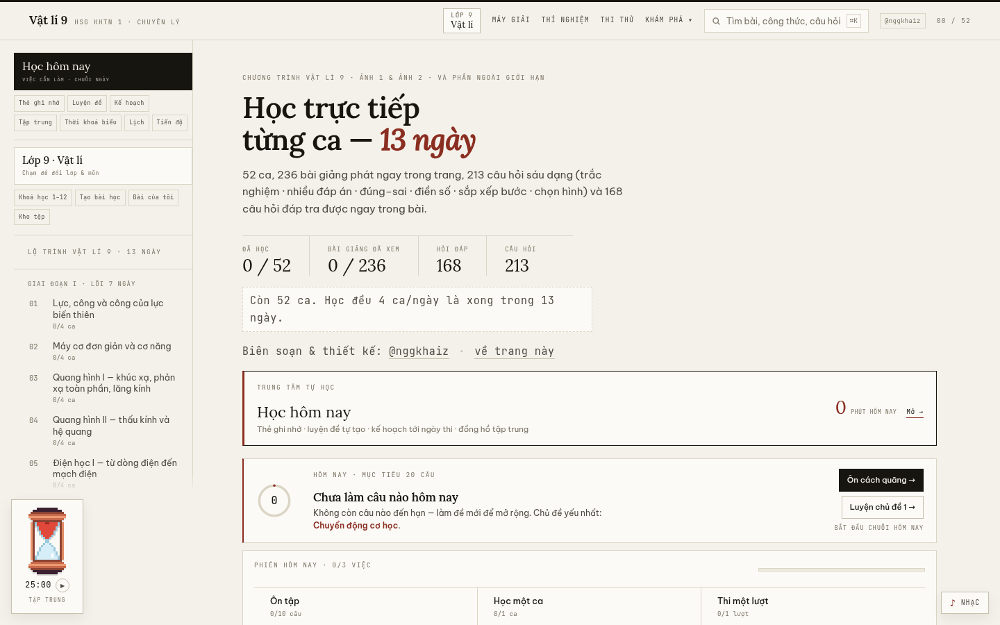

# Học mọi thứ · Vật lí 9 → Chuyên Lý

> Một trang web duy nhất để **học mọi thứ liên quan đến việc học**: lộ trình 52 ca Vật lí 9 và luyện thi chuyên Lý,
> trường học lớp 1–12 đủ 13 môn, **thời khoá biểu — kế hoạch — lịch** chỉn chu, thẻ ghi nhớ, luyện đề, phòng thí nghiệm,
> giải mạch điện, đồng hồ tập trung… Tất cả nằm trong **một tệp `index.html`**, chạy offline, dữ liệu lưu trong máy bạn.

<p>
  
  
  
  
  
</p>

**Tác giả & chủ sở hữu: [`@nggkhaiz`](https://github.com/Ngg.Khaiz)** · mã nguồn mở theo giấy phép MIT.

---

## Ảnh chụp

| Học hôm nay | Thời khoá biểu |
|---|---|
|  |  |

| Lịch tháng | Trang chủ |
|---|---|
|  |  |

---

## Có gì trong này

### 1. Lộ trình Vật lí 9 · 52 ca · thi chuyên Lý
- 13 ngày × 4 ca, soạn theo hướng **hiểu bản chất → vận dụng → chốt kỹ năng**, ưu tiên cách giảng của thầy Vũ Ngọc Anh.
- Mỗi ca: mục tiêu, công thức, ví dụ có lời giải từng bước, câu hỏi tự kiểm, video đã chọn lọc.
- Máy giải mạch điện (thêm/bớt R tự do), 12 đề luyện, phòng thí nghiệm ảo, ngân hàng câu hỏi.

### 2. Trường học lớp 1 → 12, mọi môn
- **14 lớp · 13 môn · 48 bài mẫu** viết theo chương trình GDPT 2018, có câu hỏi và đáp án.
- Tự tạo bài học, xuất/nhập `.json`, tải tệp lên (ảnh, PDF, tài liệu) — lưu trong IndexedDB, tối đa 40 MB/tệp.

### 3. Study OS — hệ thống dạy bạn học
| Trang | Việc nó làm |
|---|---|
| `#/study` **Học hôm nay** | chào theo giờ, mục tiêu phút, 4–5 việc của ngày, heatmap 12 tuần, KPI thẻ, khối **“Hôm nay có gì” + đếm ngược kỳ thi** |
| `#/cards` **Thẻ ghi nhớ** | lặp lại cách quãng **7 hộp** (10 phút → 1 → 2 → 4 → 8 → 16 → 32 ngày), tự chấm 4 mức, phím 1–4 |
| `#/practice` **Luyện đề tự tạo** | gom câu hỏi mọi lớp/môn, chấm đúng/sai, tạo thẻ từ câu sai |
| `#/plan` **Kế hoạch học** | nhập ngày thi + phút/ngày → chia đều từng ngày tới hạn |
| `#/focus` **Đồng hồ tập trung** | 15/25/45/50 phút, chạy tiếp khi đổi trang, nhật ký + chuông |
| `#/progress` **Tiến độ tổng** | 5 KPI, gợi ý việc nên làm, độ chính xác theo môn, in báo cáo |

### 4. Thời khoá biểu · Kế hoạch · Lịch  *(v10)*
- **`#/timetable`** — lưới tuần 2→7, chia sáng/chiều, chỉnh số tiết; bấm ô để thêm môn · tiết · GV · màu tại chỗ;
  nhiều bảng (chính khoá / ôn thi / lịch hè); **Tự xếp môn** nhận cả dấu phẩy, chấm phẩy và xuống dòng;
  **In / lưu PDF** có dòng ký tên `@nggkhaiz`.
- **Đưa vào lịch tuần này** — biến từng tiết thành việc có giờ thật (sáng 07:00–11:05, chiều 13:30–17:40), chống trùng.
- **`#/calendar`** — tháng & tuần, ô ngày 104px, màu theo loại (thi / deadline / buổi học / khác), tick xong tại chỗ,
  **xuất `.ics`** để nhập vào Google · Apple · Outlook Calendar.
- **`#/study`** — khối “Hôm nay có gì” + ô đếm ngược ngày tới kỳ thi gần nhất.

### 5. Phòng thí nghiệm & công cụ
- Vẽ mạch bằng **kéo–thả icon** xuống sân, sửa tại chỗ, nhập công thức là ra hình; đủ loại nguồn điện.
- Thí nghiệm ánh sáng – thấu kính, động năng, con lắc; đồ thị tự căn lại sau khi vẽ.
- Máy tính khoa học, bảng tuần hoàn, công thức, tra cứu, nghe nhạc (theo link của bạn), pomodoro đồng hồ cát pixel-art.

### 6. Giao diện
- **13 theme** basic – sang trọng: `paper` (mặc định, editorial), `midnight`, `moss`, `slate`, `amber`, `pixel`, `pixelnight`, `ivory`, `bordeaux`, `ink`, `lotus`, `graphite`, `ocean`… mỗi theme có **14 màu nhấn**.
- Chữ Việt, in ấn sạch (ẩn thanh điều hướng), phím tắt ⌘K, chạy tốt trên điện thoại 390px.
- **`@nggkhaiz`** có mặt ở: hero trang chủ, thanh trên, chân trang, `#/about`, bản in, tiêu đề tab, `<meta>`.

---

## Bắt đầu

### Chỉ để học
Mở `index.html` bằng trình duyệt. Không cần mạng, không cần cài gì, không cần tài khoản.

### Dựng lại từ mã nguồn
```bash
python3 src/build.py      # ghép src/* → index.html   (hoặc: npm run build)
node tools/check.js       # kiểm tra cú pháp + dấu hiệu nhận diện (hoặc: npm run check)
python3 -m http.server 8124   # mở http://localhost:8124
```
Chỉ cần **Python 3** để build, **Node 18+** để kiểm tra. Không có dependency nào phải cài.

### Đưa lên GitHub Pages
1. Đẩy repo lên GitHub (nhánh `main`).
2. **Settings → Pages → Build and deployment → Source: GitHub Actions.**
3. Workflow `.github/workflows/pages.yml` sẽ tự deploy mỗi lần push; địa chỉ:
   `https://<tên-tài-khoản>.github.io/<tên-repo>/`

> Nếu bạn đặt tên repo khác `vat-li-9-study-os`, nhớ sửa `homepage` trong `package.json` và dòng này cho khớp.
> Tài khoản GitHub hiển thị `github.com/Ngg.Khaiz` — nếu username thật khác (GitHub không cho dấu chấm), chỉ cần đổi phần link, tag `@nggkhaiz` trong giao diện giữ nguyên.

---

## Cấu trúc

```
.
├── index.html              # BẢN CHẠY — một tệp, 953 KB, mở là dùng
├── src/
│   ├── build.py            # ghép mọi mô-đun thành index.html
│   ├── base.html           # khung HTML gốc (lấy từ bản kế hoạch v4)
│   ├── app.js              # router, trang chủ, đọc bài, ⌘K
│   ├── app.css             # toàn bộ giao diện + 13 theme
│   ├── schedule.js  (v10)  # thời khoá biểu · lịch · .ics · about
│   ├── study.js     (v9)   # Study OS: thẻ, luyện đề, kế hoạch, tiến độ
│   ├── school.js           # trường học lớp 1–12
│   ├── solver*.js          # giải mạch điện
│   ├── lab.js / sim.js / board.js   # thí nghiệm, mô phỏng, bảng vẽ
│   ├── settings.js         # theme + màu nhấn
│   └── …                   # nội dung, công cụ, nhạc, pomodoro, store
├── tools/
│   ├── check.js            # kiểm tra tĩnh (CI dùng cái này)
│   └── qa/                 # bộ test chạy trong trình duyệt (playwright-cli)
├── docs/
│   ├── HANDOFF.md          # bàn giao kỹ thuật: schema, route, bài học
│   ├── SPRINT-LOG.md       # nhật ký 10 sprint
│   └── img/                # ảnh chụp cho README
└── .github/workflows/      # pages.yml (deploy) · check.yml (CI)
```

---

## Dữ liệu của bạn

| Khoá | Nội dung |
|---|---|
| `vnl9.v2` | toàn bộ trạng thái: tiến độ, ghi chú, thẻ, kế hoạch, `sched` (thời khoá biểu + lịch) |
| `vnl9.prefs` | theme, màu nhấn, cỡ chữ, nhạc |
| `vnl9.b1`, `vnl9.b2` | bản sao dự phòng luân phiên |
| IndexedDB | tệp bạn tải lên |

- Không có máy chủ, **không gửi dữ liệu đi đâu**. Xoá dữ liệu trình duyệt là mất — hãy dùng **Sao lưu** trong `#/study` hoặc `#/progress` để xuất `.json`.
- Đổi máy: xuất bản sao lưu → nhập lại ở máy mới.
- Lịch: **Xuất .ics** để mang sang Google/Apple Calendar.

---

## Kiểm thử

| Bộ | Phạm vi | Kết quả |
|---|---|---|
| `tools/qa/sched.js` | thời khoá biểu, lịch, `.ics`, theme, `@nggkhaiz` | **21/21** |
| `tools/qa/study.js` | Study OS | **21/21** |
| `tools/qa/school.js` | trường học 1–12 | 26/26 |
| `tools/qa/board.js` | bảng vẽ | 17/17 |
| `tools/qa/sim.js` | mô phỏng | 19/19 |
| `tools/qa/audit.js` | **30 tuyến** × desktop 1500×1000 & mobile 390×844 | 0 tràn · 0 lỗi JS |

Bộ QA chạy bằng `playwright-cli` trong trình duyệt thật (xem `docs/HANDOFF.md`).

---

## Lộ trình tiếp theo

- [ ] Xuất thời khoá biểu ra **ảnh PNG** để dán vào group lớp.
- [ ] **Sinh lịch ôn ngược từ ngày thi** (đổ vào `#/plan` và `#/calendar`).
- [ ] Nhắc việc theo giờ trên dashboard + badge số việc hôm nay ở thanh trên.
- [ ] Đồng bộ 2 chiều với Google Calendar (hiện đã có một chiều qua `.ics`).
- [ ] Chế độ giáo viên: giao bài, xem tiến độ học sinh qua mã chia sẻ.

---

## Giấy phép & ghi công

MIT © 2026 **[@nggkhaiz](https://github.com/Ngg.Khaiz)**.

Nội dung, mã nguồn và thiết kế thuộc về tác giả. Nếu dùng lại, vui lòng **giữ nguyên dòng ghi công `@nggkhaiz`** trong giao diện và trong README này.
Ý tưởng giảng dạy tham khảo hướng tiếp cận của thầy Vũ Ngọc Anh; video thuộc về các kênh gốc trên YouTube.
